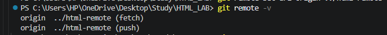
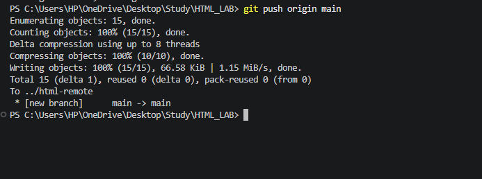
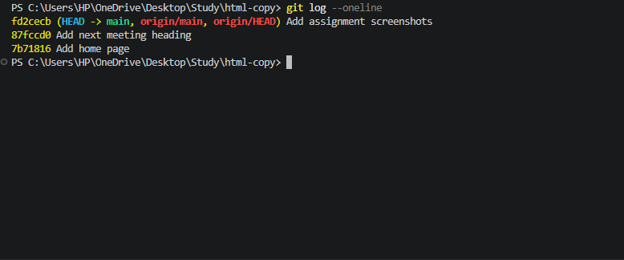

Assignment 2: Pushing and Cloning a Repository

Name: Daniyal Malik
Roll Number: 2510303175
Assignment Number: 02

Aim

Send your commits to a second repository on your computer and make a copy of it with clone.

Task 1: Add Remote and Push Commits
Created a remote Git repository.
Configured the remote URL using git remote add origin.
Pushed commits from the local repository to the remote branch using git push.
Output

Task 2: Clone the Repository
Executed git clone to create a replica of the repository in a new directory.
Verified successful cloning and working directory files.
Output

Task 3: Verify Cloned Repository History
Navigated to the cloned repository directory.
Inspected the commit history using git log --oneline.
Verified commit consistency between repositories.
Output

Result

Successfully pushed commits to a remote repository and created a verified clone of the repository using Git.

Assignment 2 Successfully Completed.
