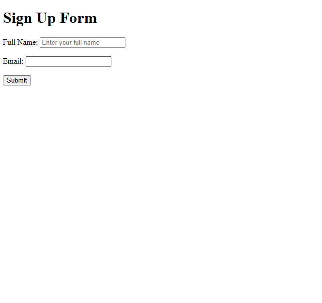

Assignment 8: HTML Forms and Validation

Name: Daniyal Malik
Roll Number: 2510303175
Assignment Number: 08

Aim

To create interactive HTML forms utilizing input types, radio button selection groups, and form validation attributes.

Task 1: Sign Up Form and Submission
Created thanks.html and form structure configuring action and post method attributes.
Implemented text, email, and password input fields with submission handling.
Output

Task 2: Radio Button Selection Form
Created choices.html with radio input groups.
Used corresponding label tags with for attributes bound to input id elements.
Output

.png)

Task 3: Form Validation
Created signup-required.html adding HTML5 client-side validation.
Applied required constraints, placeholder hints, and specific email input types.
Output

.png)

Result

Successfully developed interactive web forms with input controls, option selections, and validation rules.

Assignment 8 Successfully Completed.
