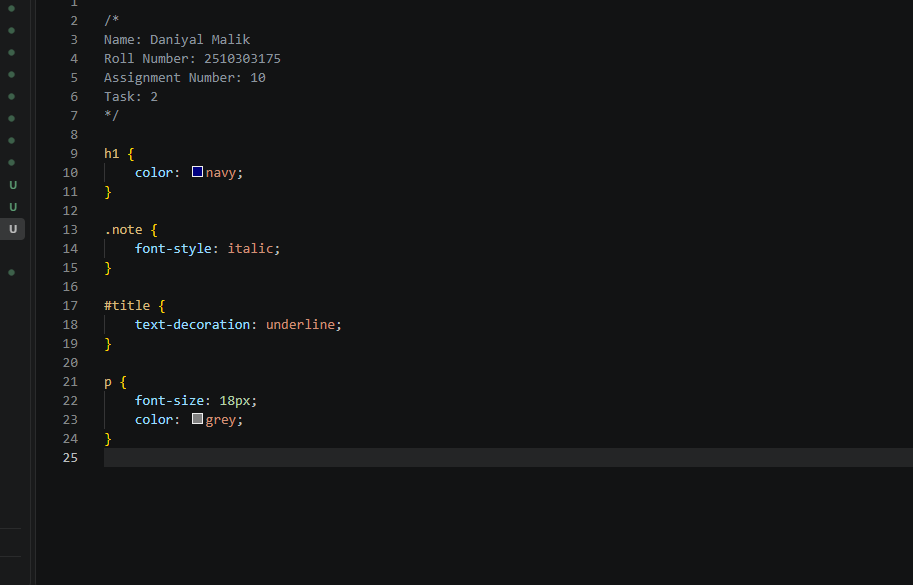

Assignment 10: Introduction to CSS

Name: Daniyal Malik
Roll Number: 2510303175
Assignment Number: 10

Aim

To style web documents using Inline CSS, Internal style blocks, and External CSS stylesheets.

Task 1: Inline and Internal CSS
Created inline-internal.html applying inline styles directly on elements and internal styles inside style tags.
Targeted elements using element and class selectors (.highlight).
Output

.png)

Task 2: External CSS Stylesheet
Created style.css defining centralized style rules for titles (#title), paragraphs, and note classes.
Ensured separation of concerns between structure and style.
Output

Task 3: Linking External Stylesheet
Created linked.html and linked external stylesheet using link rel="stylesheet" href="style.css".
Verified typography, colors, and styling rules rendered uniformly.
Output

.png)

Result

Successfully demonstrated three core methods of applying CSS: inline styles, internal stylesheets, and external stylesheets.

Assignment 10 Successfully Completed.
