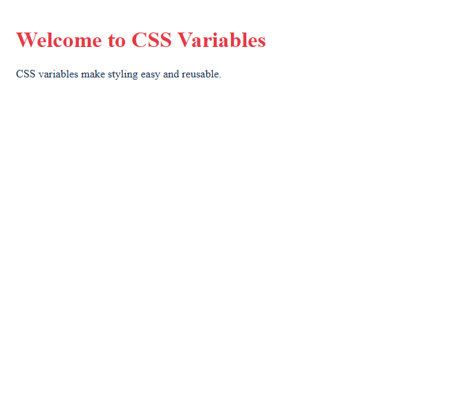

Assignment 11: CSS Units, Variables, and Design Tokens

Name: Daniyal Malik
Roll Number: 2510303175
Assignment Number: 11

Aim

To implement CSS sizing units, custom properties (variables), and reusable design tokens.

Task 1: CSS Units
Created units.html demonstrating both absolute units (px) and relative units (%, rem).
Compared flexible element widths against fixed dimension containers.
Output

.png)

Task 2: CSS Variables
Created variables.html declaring custom CSS variables in the :root pseudo-class.
Referenced variables using var(--main-color), var(--accent-color), and var(--page-padding).
Output

Task 3: Design Tokens
Created tokens.css and tokens.html implementing systematic design tokens.
Structured design tokens for palette colors, font scale, and component spacing in an external stylesheet.
Output

.png)

Result

Successfully utilized CSS units, custom CSS variables, and design tokens for maintainable front-end styling.

Assignment 11 Successfully Completed.
